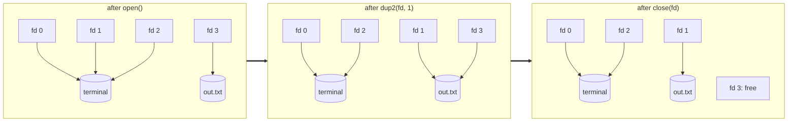

# file descriptors and redirection

read this before [M4](../milestones/m04-redirections.md); you'll need
it again for [M5](../milestones/m05-pipes.md).

## a file descriptor is an index

every process has a table of open files, and a file descriptor is just an
index into it. `open()` returns the lowest free index. by convention every
program starts with three already open:

```
fd   name     usually
0    stdin    the terminal (keyboard)
1    stdout   the terminal (screen)
2    stderr   the terminal (screen)
```

`printf()` writes to fd 1. `scanf()` reads from fd 0. neither knows nor
cares what is behind them: a terminal, a file, a pipe, a network socket.
and that's what makes redirection possible.

## inherited across fork and exec

`fork()` copies the fd table: the child's fd 1 refers to the same open file
as the parent's. `exec()` keeps it. so a shell controls where a program's
output goes by arranging fd 1 *in the child, before exec*.

## the three calls

```c
int fd = open("out.txt", O_WRONLY | O_CREAT | O_TRUNC, 0644);
dup2(fd, STDOUT_FILENO);   /* fd 1 now refers to out.txt too */
close(fd);                 /* the extra reference is not needed */
execv(path, argv);         /* the program writes to fd 1, into out.txt */
```

in pictures:



`dup2(old, new)` closes `new` if it was open, then makes it a copy of
`old`. both now refer to the same open file, sharing its offset.

## the flags, per operator

| shell | open flags | fd |
|---|---|---|
| `< file` | `O_RDONLY` | 0 |
| `> file` | `O_WRONLY \| O_CREAT \| O_TRUNC` | 1 |
| `>> file` | `O_WRONLY \| O_CREAT \| O_APPEND` | 1 |
| `2> file` | `O_WRONLY \| O_CREAT \| O_TRUNC` | 2 |

the `0644` mode argument is *required* with `O_CREAT`. `open()` is variadic,
so if you leave it out, the compiler will not complain and the new file
gets whatever garbage was in that register as its permissions.

`O_APPEND` is not the same as seeking to the end once. with `O_APPEND`
every write goes to the current end, even if another process wrote in
between, which is what makes two programs appending to one log safe.

## common mistakes

if you redirect in the shell instead of the child, the shell's own stdout
becomes the file, and everything it prints afterwards lands there too. do
it in the child, after fork.

if you don't close the fd you got from `open()`, the program you exec
inherits it as a stray fd 3. that's harmless here, but the same mistake
with a pipe in M5 makes things hang.

if `open()` fails, the command shouldn't run at all; `cat < missing` must
not start `cat`. report the error with `ts_error()` and `_exit()` the
child.

order matters. `cmd > a > b` creates both files and writes to `b`, because
redirects are applied left to right and the second `dup2` replaces the
first.

## builtins are different (stretch)

`cd /tmp > out` runs inside the shell, with no child to throw away. to
redirect a builtin you have to save the shell's fd first and put it back:

```c
int saved = dup(STDOUT_FILENO);
/* open + dup2 + close as usual */
run_the_builtin();
dup2(saved, STDOUT_FILENO);
close(saved);
```

TinyShell refuses redirects on builtins until you implement this.

## try it

```sh
ls -l /proc/self/fd        # the fd table of the ls process itself
ls -l /proc/self/fd > /tmp/x; cat /tmp/x   # fd 1 is now /tmp/x
```

## man pages

`man 2 open`, `man 2 dup2`, `man 2 close`, `man 3 stdin`
