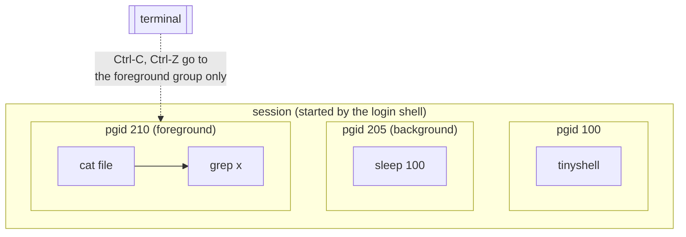

# terminal job control

this is background for M6 and M7. actually implementing it goes beyond
M10, and it's optional; this is the part of shells that has a reputation
for being hard.

## the pieces

a *process group* is a set of processes that receive terminal signals
together. every process belongs to one, identified by a pgid (usually the
pid of its first member). a pipeline is one job, so all its processes go in
one group.

a *session* is a set of process groups attached to one terminal. the login
shell creates it.

of the groups in a session, exactly one is in the *foreground*. the terminal sends Ctrl-C (SIGINT),
Ctrl-\ (SIGQUIT) and Ctrl-Z (SIGTSTP) to *that group*, and only that group
may read from the terminal.

## what a job-control shell does

at startup the shell puts itself in its own group with `setpgid(0, 0)` and
takes the terminal with `tcsetpgrp(STDIN_FILENO, getpgrp())`.

every job gets a new group. after `fork()`, both the parent and the child
call `setpgid(child, pgid)`. it has to be both, because you don't know
which one runs first, and the group needs to exist before either relies on
it.

to run a job in the foreground, the shell hands it the terminal with
`tcsetpgrp(STDIN_FILENO, job_pgid)`, waits, and then takes the terminal
back. it has to ignore SIGTTOU while doing that, otherwise the kernel stops
the shell for changing terminal settings while in the background.

Ctrl-Z stops the job. `waitpid()` with `WUNTRACED` reports it as
`WIFSTOPPED`, and the shell takes the terminal back and marks the job as
stopped. `fg` and `bg` resume the whole group with `kill(-pgid, SIGCONT)`;
`fg` also gives it the terminal and waits.

a background job that tries to read from the terminal gets SIGTTIN and
stops, so it doesn't fight the shell over your keystrokes.

once all that is in place, the shell doesn't need to catch SIGINT at all.
it's never in the foreground group while a job is running, so Ctrl-C never
reaches it. M7's handler is a simpler step on the way there.

## why TinyShell stops short

doing this right needs a real terminal to test against (the test suite
pipes input, where there is no controlling terminal), careful handling of
every race between fork and setpgid, and saving and restoring terminal
modes with `tcgetattr`/`tcsetattr` when jobs change them (think `vim`).
it makes a good project once you're through M10.

## if you want to try

- add `setpgid()` in exec_child and the parent, and a `tcsetpgrp()` dance
  around `wait_for_child()`.
- add `WUNTRACED` to the foreground `waitpid()`, and a `stopped` state to
  the job table.
- add `jobs`, `fg` and `bg` builtins.

the GNU libc manual's "Implementing a Job Control Shell" chapter walks
through a complete one, in C.

## man pages

`man 2 setpgid`, `man 3 tcsetpgrp`, `man 4 tty`,
`man 7 credentials`, `man 3 termios`
