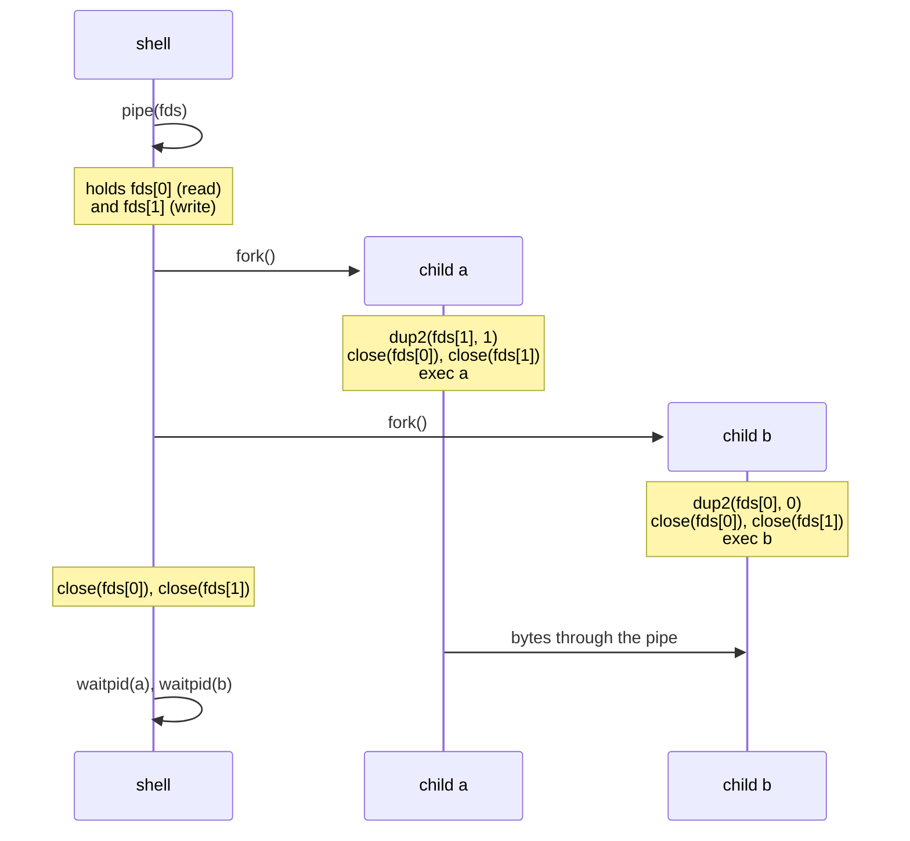
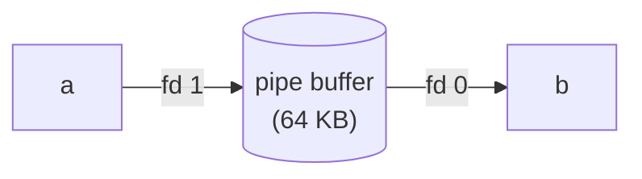
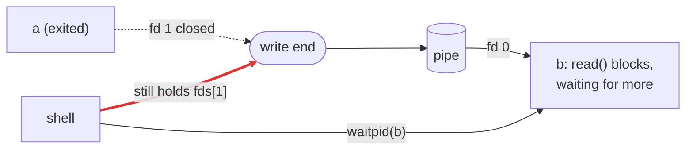

# pipes

you need this for [M5](../milestones/m05-pipes.md). read
[file descriptors](file-descriptors.md) first if you haven't.

## a pipe is a buffer with two ends

```c
int fds[2];
pipe(fds);
/* fds[0] is the read end, fds[1] is the write end */
```

bytes written to `fds[1]` come out of `fds[0]`, in order. the kernel holds
up to 64 KB in between by default. a writer blocks when it is full; a
reader blocks when it is empty.

the two rules that decide whether your shell works:

1. a reader only gets EOF once every write end is closed, in every
   process that has one.
2. a writer gets SIGPIPE (and dies, by default) once every read end is
   closed.

## `a | b` step by step



result:



## why nothing must be left open

after the two forks there are *three* copies of each end: in the shell, in
`a`, in `b`. count the write end:

| process | write end after dup2 + close |
|---|---|
| a | fd 1, which is what we want |
| b | closed |
| shell | closed |

here is the version with one close missing. the shell forgot
`close(fds[1])`:



`b` keeps waiting because a write end is still open somewhere, and the
shell keeps waiting for `b`. nobody moves.

when `a` exits, its fd 1 closes, the count drops to zero, and `b` reads
EOF. forget *any one* of those closes and `b` waits forever for a writer
that will never write. `b` never exits, the shell waits for `b`, and
everything hangs. the tests run under `timeout` for this reason, and the
message says "a pipe end left open?".

`strace -f -e trace=pipe,dup2,close,execve build/tinyshell` will show
which process still holds what.

## three or more commands

`a | b | c` needs two pipes. the pattern for command *i*:

- stdin: the read end of the previous pipe, if there is one
- stdout: the write end of a new pipe, unless it is the last command
- in the parent, after forking command *i*: close the previous read end
  and the new write end; keep the new read end for command *i + 1*

with this pattern the parent holds at most one read end at a time, so it
does not run out of descriptors on long pipelines.

## status, and waiting

wait for every child, not just the last, or the others become zombies.
the pipeline's exit status is the last command's (bash's `pipefail`
option changes that; not needed here).

## SIGPIPE in practice

`seq 1000000 | head -n 1`: `head` exits after one line, the read end closes,
and `seq`'s next write kills it with SIGPIPE. that's intended
behaviour; it is how `head` stops an endless producer. just make sure the
*shell* never writes into a pipe itself.

## try it

```sh
ls /proc/self/fd | cat       # ls's fd 1 is a pipe
ls -l /proc/self/fd | cat    # see "pipe:[12345]"
```

## man pages

`man 2 pipe`, `man 7 pipe`, `man 2 dup2`
