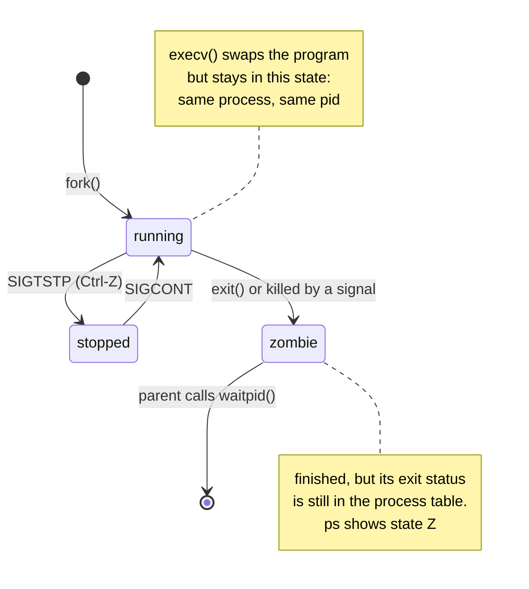

# processes and fork

everything in the shell depends on this, [M3](../milestones/m03-path.md)
and [M6](../milestones/m06-background-jobs.md) most directly.

## a process is a running program

a program is a file. a process is that file loaded into memory and
running, with its own:

- a pid, the number that identifies it (`getpid()`)
- a parent, the process that created it (`getppid()`)
- memory: code, globals, heap, stack
- a table of open file descriptors (see [file descriptors](file-descriptors.md))
- an environment, the `NAME=value` strings, `$PATH` among them
- a current directory, signal dispositions, and more

every process except the first was created by another one, with `fork()`.

## fork: one process becomes two

```c
pid_t pid = fork();
if (pid == -1) {
  /* no child was created */
} else if (pid == 0) {
  /* this is the child */
} else {
  /* this is the parent; pid is the child's pid */
}
```

`fork()` is called once and returns twice, once in each process. the child
is a copy of the parent: same code, same variables, same open files, at the
same point in the program. the only difference is the return value.

the memory is *copied*, not shared. if the child changes a variable, the
parent does not see it. this is why `cd` must be a builtin: a child that
calls `chdir()` only moves itself.

(the copy is cheap. modern kernels share the pages until one side writes,
"copy-on-write", so a fork that is followed by exec costs very little.)

## exec: replace the program

```c
char *argv[] = {"ls", "-l", NULL};
execv("/usr/bin/ls", argv);
/* only reached if execv failed */
```

`execv()` throws away the current program and loads a new one into the
*same process*: same pid, same parent, same open file descriptors, same
environment. it does not return on success, because the code that called it
no longer exists.

the family: `execv` takes a path, `execvp` searches `$PATH` for you,
`execve` also takes the environment explicitly. TinyShell uses `execv` and
does its own search (M3), so you can see how it works.

`argv` must end with a `NULL` pointer. that's how the new program knows
where the arguments stop; it is also why `TS_MAX_ARGS` reserves a slot.

## wait: collect the result

```c
int status;
waitpid(pid, &status, 0);
if (WIFEXITED(status))
  printf("exited with %d\n", WEXITSTATUS(status));
else if (WIFSIGNALED(status))
  printf("killed by signal %d\n", WTERMSIG(status));
```

the status is packed into one `int`; always unpack it with the macros.

### exit statuses the shell reports

| status | meaning |
|---|---|
| 0 | success |
| 1–125 | the program's own failure codes |
| 126 | found but could not be executed (permission, not a binary) |
| 127 | command not found |
| 128 + N | killed by signal N (Ctrl-C is SIGINT, 2, so 130) |

only 8 bits survive, which is why `exit 258` reports 2.

## zombies and orphans

when a child exits, the kernel frees almost everything but keeps its exit
status until the parent calls `waitpid()`. in between, the child is a
**zombie**: dead, but still holding a slot in the process table. `ps` shows
it with state `Z`.

one zombie is harmless. a shell that starts background jobs and never waits
for them collects zombies until `fork()` fails. `ts_jobs_reap()` in M6
is there to stop that:

```c
/* check, but do not block */
pid_t done = waitpid(job_pid, &status, WNOHANG);
/* 0: still running.  job_pid: finished, now reaped.  -1: error. */
```

if the *parent* exits first, the child is an **orphan** and is adopted by
init (pid 1) or a "subreaper", which waits for it. orphans are fine.

the whole life of a child, from the shell's point of view:



## the gap between fork and exec

this is the part that makes unix shells work. after `fork()` the child is
still running *the shell's* code, so it can prepare its environment before
the program starts:

```c
if (pid == 0) {
  /* reset signals (M7) */
  /* dup2 a file onto fd 1 (M4) */
  /* dup2 a pipe onto fd 0 (M5) */
  execv(path, argv);
  _exit(127);
}
```

the program that gets exec'd never knows any of it happened. it just finds
its stdout already pointing at a file.

note `_exit()`, not `exit()`, when exec fails: `exit()` would flush stdio
buffers that were copied from the shell, printing the shell's pending
output twice.

## try it

```sh
make run
> ps -o pid,ppid,stat,comm
```

the `ps` line shows tinyshell as its parent. `ppid` of tinyshell is the
shell you started it from.

## man pages

`man 2 fork`, `man 3 exec`, `man 2 waitpid`, `man 2 _exit`
