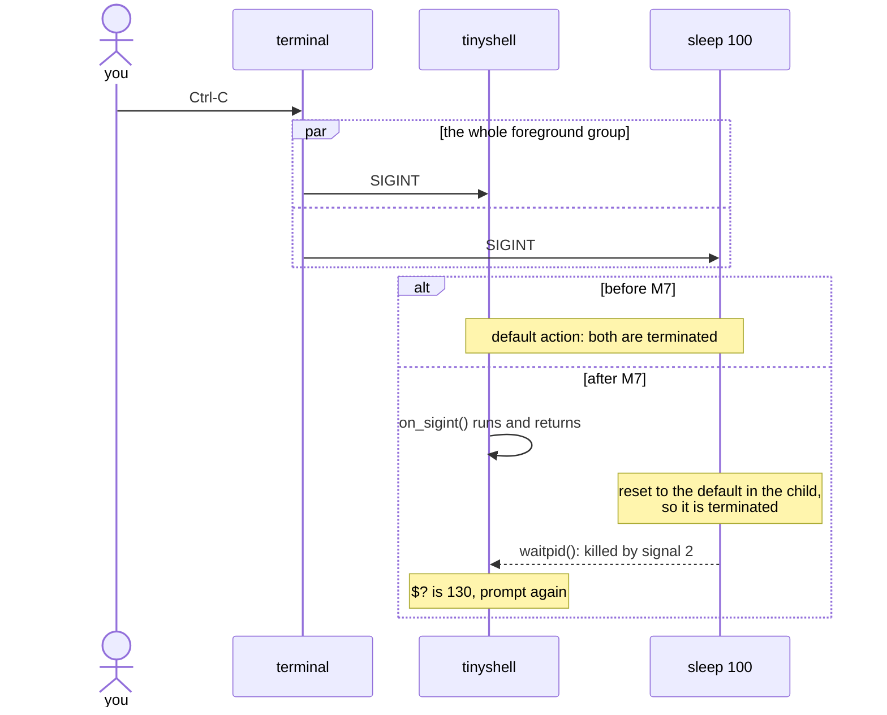
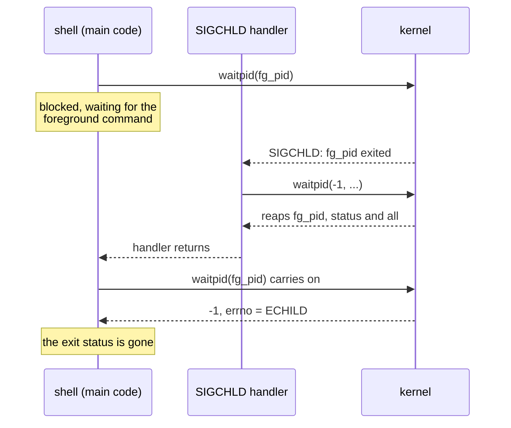

# signals

this is the background for [M7](../milestones/m07-signals.md), and it
helps with [M6](../milestones/m06-background-jobs.md) too.

## a signal is an asynchronous notification

a signal is a small integer the kernel delivers to a process, interrupting
whatever it was doing. some you will meet here:

| signal | number | sent when | default |
|---|---|---|---|
| SIGINT | 2 | Ctrl-C | terminate |
| SIGQUIT | 3 | Ctrl-\ | terminate + core dump |
| SIGTSTP | 20 | Ctrl-Z | stop |
| SIGCHLD | 17 | a child exited or stopped | ignore |
| SIGPIPE | 13 | write to a pipe with no reader | terminate |
| SIGKILL | 9 | `kill -9` | terminate, cannot be caught |

(use the names in code, not the numbers.)

for each signal a process has a *disposition*: default, ignore
(`SIG_IGN`), or call a handler function.

## why Ctrl-C kills the shell today

Ctrl-C does not go to "the current program". the terminal sends SIGINT to
every process in its *foreground process group*. the shell and the command
it is running are in the same group, so both get it, and both die.



the fix: the shell handles SIGINT (and survives), while the child gets the
default (and dies). bash also puts each job in its own process group; see
[terminal job control](job-control.md).

## sigaction, not signal

```c
static void on_sigint(int signo) {
  (void)signo; /* nothing to do; we just want to survive */
}

struct sigaction action;
memset(&action, 0, sizeof(action));
action.sa_handler = on_sigint;
sigemptyset(&action.sa_mask);
action.sa_flags = 0;               /* no SA_RESTART: see below */
if (sigaction(SIGINT, &action, NULL) == -1)
  ts_error("sigaction");
```

`signal()` is older and its semantics depend on how you compile. with this
project's flags, glibc gives you the old System V behaviour: the handler is
reset after the first delivery, so the second Ctrl-C kills you. you can see
it with a ten-line program that installs a handler with `signal()` and
calls `raise()` twice. `sigaction()` spells out every detail, so use that.

## EINTR and SA_RESTART

when a signal handler runs while the process is blocked in a system call
(`read`, `waitpid`), that call can fail with `errno == EINTR`. two options:

- set `SA_RESTART`, and the kernel restarts most calls automatically;
- leave it out, and handle EINTR where it matters.

for SIGINT, TinyShell wants the interruption: Ctrl-C at the prompt should
abandon the half-typed line. `read_line()` already turns EINTR into a fresh
prompt, and `wait_for_child()` already retries `waitpid()` on EINTR. both
were written that way in advance for this milestone.

## what a handler may do

a handler can run *between any two instructions* of your program, possibly
in the middle of `malloc()` or `printf()`, while their internal state is
half updated. calling them again from the handler can corrupt that state or
deadlock. so:

- call only async-signal-safe functions (`man 7 signal-safety`):
  `write()`, `_exit()`, `waitpid()`, `sigaction()` are on the list.
  `printf()`, `malloc()`, `strerror()` are not.
- share data with the main program only through
  `volatile sig_atomic_t` variables.
- save and restore `errno` if you call anything that might change it.

the safest handler sets a flag and returns; the main loop checks the flag.

## what survives exec

what happens to dispositions across fork and exec:

| disposition | after fork | after exec |
|---|---|---|
| default | default | default |
| ignored | ignored | **still ignored** |
| handler | handler | reset to default |

so if your shell *ignores* SIGINT with `SIG_IGN` and does not reset it in
the child, every program you run becomes immune to Ctrl-C. the test "SIGINT
still kills the foreground program" is there to catch it. reset to
`SIG_DFL` in `ts_signals_reset_for_child()`, between fork and exec.

## SIGCHLD and the stolen status



SIGCHLD tells the shell a child finished, which is handy for reaping
background jobs (M6). the catch is that a handler that calls `waitpid(-1, ...)` can
reap the *foreground* child too, and then the shell's own `waitpid(pid)`
fails with ECHILD and the exit status is lost. keep the handler to setting
a flag, and reap known background pids from the main loop.

## try it

```sh
sleep 100 &
kill -INT %1      # send SIGINT yourself
trap -p           # bash: show current handlers
```

## man pages

`man 7 signal`, `man 2 sigaction`, `man 7 signal-safety`, `man 2 kill`
