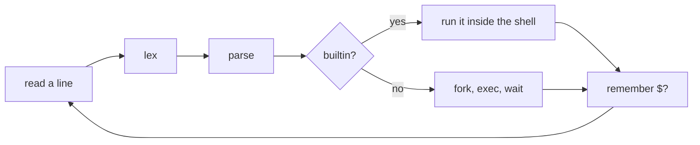
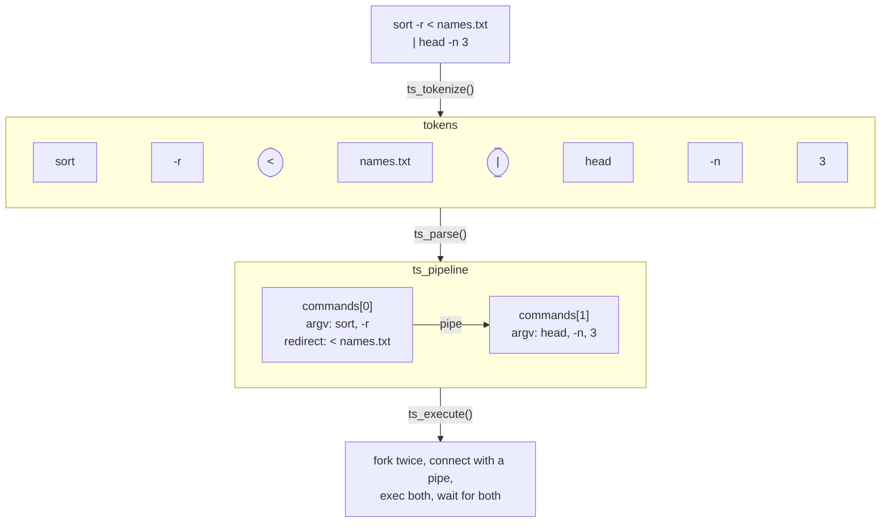
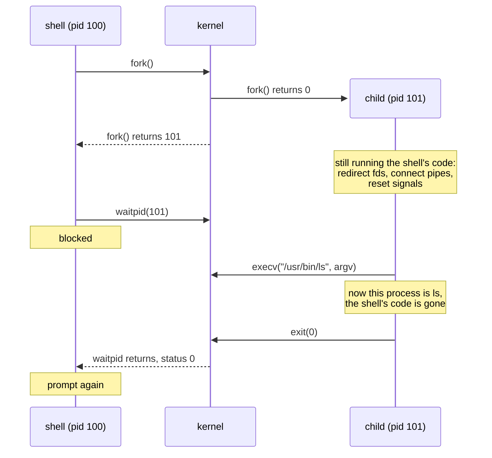

# How a shell works

a shell is an ordinary program. it doesn't have special privileges or a
private line to the kernel. it reads a line, figures out which program you
meant, asks the kernel to run it, waits for it to finish, and reads the
next line. bash, zsh and fish all do this; they've just had forty years to
add features.

## the loop

reading happens in `read_line()` in `src/tinyshell.c`. it gets one line of
input and has to cope with end of file, lines that are too long, and (once
you've done M7) Ctrl-C.

`ts_tokenize()` in `src/parser.c` splits the line into tokens: words, and
operators like `|`, `>` and `&`. then `ts_parse()`, in the same file,
groups those tokens into a pipeline of commands, each with its own `argv[]`
and list of redirects.

if the command is a builtin, `src/builtins.c` runs it inside the shell.
otherwise `src/executor.c` forks and execs it.

last, the exit status gets stored in `last_status` in `src/tinyshell.c`,
for `$?` and for `exit`.

here's one line going through all of that. the rounded tokens are
operators; the parser turns them into structure, so they never reach a
program's `argv`.

two rules come out of this. builtins have to be checked before forking,
because a change made in a child (its directory, its variables) never makes
it back to the shell. and the status has to be saved somewhere that outlives
the function that ran the command, or it's gone by the time the next line
comes in.

## fork, exec, waitpid

running a program takes three system calls:

`fork()` makes a copy of the calling process. both copies carry on from the
same point; the parent gets the child's pid back, the child gets 0.
`execv()` swaps the program running in a process for a different one, keeping
the same pid and the same open files. it only returns if something went
wrong. `waitpid()` makes the parent wait until the child exits and gives it
the exit status.

you might wonder why unix splits this into fork and exec instead of having
one "start this program" call. it's because of the gap between them. after
`fork()` the child is still running the shell's code, so it can rearrange
its own file descriptors and signal handlers before the new program takes
over. redirection, pipes and signal handling are all done in that gap.
[processes and fork](concepts/processes.md) has more.

## the prompt goes to stderr

the shell writes its prompt and its error messages to stderr, never
stdout. stdout carries the output of whatever program you ran, and it might
be going to a file or a pipe; the shell's own messages shouldn't end up in
there. `tinyshell > out.txt` should put `ls`'s output in the file and
nothing else.

the prompt is also only shown when stdin is a terminal (`isatty()`). that
keeps the output clean for `tinyshell < script.sh`, and for the tests.
