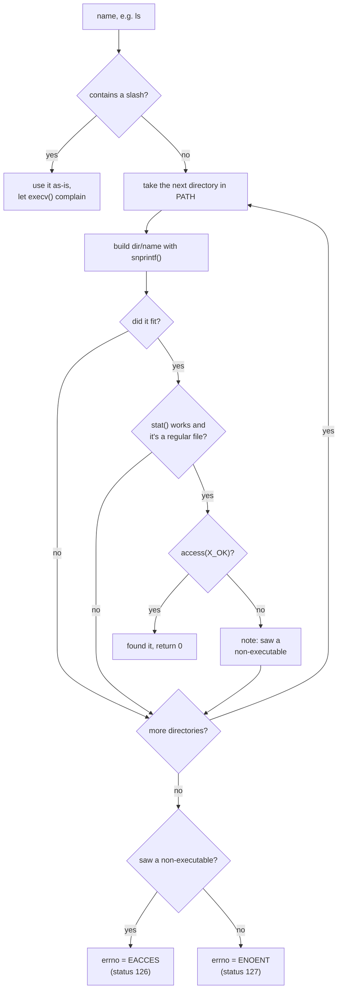

# M3: PATH lookup

the last of the finished ones. the function is `ts_find_in_path()` in
`src/path.c`, it gets called from `exec_child()` in `src/executor.c`, and
there are unit tests for it in `tests/unit_tests.c`.

```
> ls
README.md  src  tests
> /bin/echo direct
direct
> nosuchthing
tinyshell: nosuchthing: command not found
```

## what PATH is for

`execv()` wants a path to a file. the kernel has no idea what "ls" means.
working out which file you meant is the shell's job, and `$PATH` is where
it looks:

```
PATH=/usr/local/bin:/usr/bin:/bin
```

go through the directories left to right and use the first one that
contains an executable file with that name.

`execvp()` does all of this for you, and the shell used it until this
milestone. doing it by hand is how you find out about the edge cases.

## the edge cases

if the name has a `/` in it anywhere, don't search. `./script`, `/bin/ls`
and `../tool` all mean that exact file.

a directory can have its `x` bit set (for directories it means you're
allowed to enter them), so `access(path, X_OK)` will happily say yes to a
directory called `ls`. the code calls `stat()` first and skips anything
that isn't a regular file.

a file that exists but isn't executable gets skipped too, but the function
remembers it saw one. if nothing runnable turns up later in PATH, "permission
denied" is more useful to the user than "not found".

an empty entry, like the middle of `/bin::/usr/bin`, means the current
directory. that's a POSIX rule from long ago and mostly a way to get
tricked into running the wrong thing, but it's the rule.

if PATH isn't set at all, the shell falls back to
`/usr/local/bin:/usr/bin:/bin`.

all of that together:



## walking PATH

```c
const char *dir_start = path;
for (;;) {
  const char *dir_end = strchr(dir_start, ':');
  size_t dir_length = dir_end ? (size_t)(dir_end - dir_start)
                              : strlen(dir_start);
  /* build "dir/name" with snprintf("%.*s/%s", ...) */
  if (dir_end == NULL)
    break;
  dir_start = dir_end + 1;
}
```

the string `getenv("PATH")` hands back is the environment's own memory.
`strtok()` would split it by writing `'\0'` bytes into it, which changes
`$PATH` for the shell and everything it runs afterwards. two pointers and
`%.*s`, which prints exactly `dir_length` characters, get the job done
without writing anything.

## snprintf and truncation

```c
int written = snprintf(out, out_size, "%.*s/%s", (int)dir_length,
                       dir_start, name);
if (written >= 0 && (size_t)written < out_size) {
  /* fits, check this candidate */
}
```

`snprintf()` returns the length the string *would* have had. if that's
`out_size` or more, the result got cut off, and a cut-off path points at
some other file. you'll see this check all over the codebase.

## 126 and 127

127 means nothing by that name was found anywhere. 126 means something was
found but couldn't be run, usually a missing `x` bit. the function signals
which one by returning -1 and setting `errno` to `ENOENT` or `EACCES`, the
same way a system call would.

## questions to try

1. the lookup happens in the child, after `fork()`. what would change if
   the shell did it before forking?
2. a directory named `ls` is first in PATH. what does `access(X_OK)` say
   about it?
3. what goes wrong if you run `strtok()` on the result of `getenv()`?

## if you want more

bash caches lookups in a hash table (`hash -r` clears it). think about why
that's worth having and what breaks when you install a new program. or
write a `type` builtin that says whether a name is a builtin and where in
PATH it lives.
