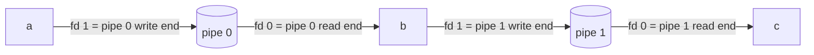

# M5: pipes

you'll be filling in `run_pipeline()` in `src/executor.c`. the
[pipes](../concepts/pipes.md) chapter covers the theory; this one is about
the code. `make test MILESTONE=5` when you're ready.

```
> echo hello | tr a-z A-Z
HELLO
> seq 5 | sort -r | head -n 1
5
```

## where you're starting from

the parser turns `a | b | c` into a `ts_pipeline` with `count == 3`, and
each `commands[i]` has its own argv and redirects. `ts_execute()` already
sends anything with more than one command to `run_pipeline()`, which right
now just prints an error.

two helpers in the same file will save you work. `exec_child(command)`
does everything a child needs after fork (signals, redirects, PATH, exec)
and never returns. `wait_for_child(pid)` waits and turns the result into a
shell status.

## the plan



keep a variable `read_end`, starting at -1, holding the read end of the
previous pipe. then for each command:

1. if it isn't the last one, call `pipe(fds)`.
2. `fflush(NULL)` and `fork()`.
3. in the child, `dup2(read_end, STDIN_FILENO)` if there's a previous pipe,
   and `dup2(fds[1], STDOUT_FILENO)` if this isn't the last command. close
   every pipe fd the child still has, then call `exec_child()`.
4. in the parent, save the pid, close the old `read_end` and `fds[1]`, and
   set `read_end = fds[0]` for the next round.

after the loop, wait for every pid you saved. the pipeline's status is the
status of the last command.

## when it hangs

it will probably hang at least once. a reader only sees end of file when
every copy of the write end has been closed, and after a couple of forks
there are copies in the parent and in every child. leave one open anywhere
and the last command waits forever for input that never comes. the tests
run under `timeout` so you get a message instead of a frozen terminal, and
`strace -f` will show you which process is still holding the fd.

don't wait for each child right after forking it, either. if `a` writes
more than the pipe can hold (64 KB) before `b` exists, `a` blocks
and never finishes. start them all, then wait.

wait for all of them, not just the last, or the others stay around as
zombies. and if `pipe()` or `fork()` fails partway through, close what
you've opened and still wait for the children you already started.

when the tests pass (under `make test-debug` too), try `yes | head -n 3`.
it should print three lines and stop, because `yes` gets SIGPIPE once
`head` exits. `ls /proc/self/fd | cat` is a quick way to check you're not
leaking pipe ends into the children.

## questions to try

1. draw the fd tables of the parent and both children for `a | b`, right
   after the second fork, before anything is closed.
2. the parent never writes to the pipe. why does its open write end still
   make `b` hang?
3. why start every command before waiting for any of them?

## if you want more

`cd /tmp | cat` currently goes looking for `cd` in PATH. bash runs builtins
inside a pipeline in a forked copy of itself; you could too. bash also has
`set -o pipefail` and `$PIPESTATUS` if you want to report more than the
last status.
