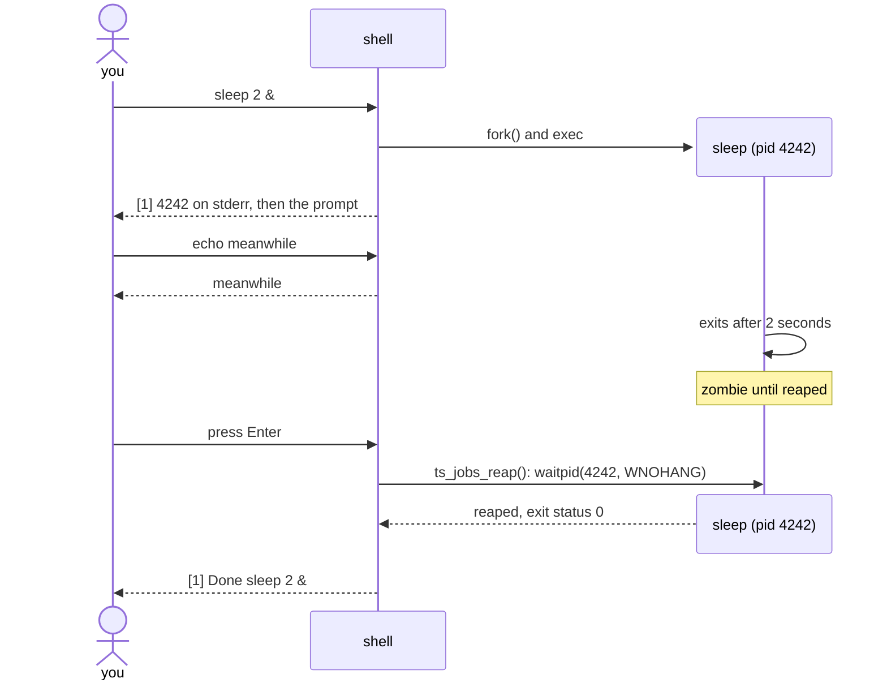

# M6: background jobs

two functions this time: `run_background()` in `src/executor.c` and
`ts_jobs_reap()` in `src/jobs.c`. the section on zombies in
[processes and fork](../concepts/processes.md) is the background reading.

```
> sleep 2 &
[1] 4242
> echo meanwhile
meanwhile
> (two seconds later, press Enter)
[1] Done  sleep 2 &
```

## where you're starting from

the parser sets `pipeline->background` when a line ends in `&`, and
`ts_execute()` already sends those lines to `run_background()`. `jobs.c`
has a fixed-size job table, and `ts_jobs_add(pid, line)` puts an entry in
it and hands back the job number. `shell_step()` calls `ts_jobs_reap()` at
the start of every loop, before the prompt.

## starting a job

in `run_background()`, `spawn()` the first command, add it to the job
table, print `[id] pid` to stderr, and return 0. don't wait. include
`jobs.h`. (background pipelines can wait until single commands work.)

the job notice goes to stderr because it's the shell talking. if someone
runs `tinyshell < script > out`, they want the commands' output in `out`,
not the shell's announcements.

the status is 0 because starting the job worked. whether the job itself
succeeds isn't known yet.

## reaping

here's the whole sequence, from typing the command to seeing "Done":



in `ts_jobs_reap()`, go through the jobs that are in use and ask about each
one without blocking:

```c
pid_t result = waitpid(job->pid, &status, WNOHANG);
```

0 means it's still running, so leave it. getting the pid back means it
finished and has now been reaped: print `[id] Done  command` and free the
slot. -1 with `errno == EINTR` means try again; any other -1 (usually
`ECHILD`) means it's gone, so free the slot. you'll need `<errno.h>` and
`<sys/wait.h>`.

if you never reap, each finished job sits in the process table as a
zombie (`Z` in `ps`). one of the tests runs a helper that counts them.

you could use `waitpid(-1, &status, WNOHANG)` in a loop instead. at the top
of the main loop that's safe, since there's no foreground child then. it
stops being safe once you're in a signal handler (M7), where it can grab
the foreground child's status out from under `wait_for_child()`. waiting on
each job's own pid works in both places.

when the tests pass, try it by hand: `sleep 1 &`, wait a moment, press
Enter, and check `ps` for leftovers.

## questions to try

1. what's left of a process once it's a zombie, and why does the kernel
   keep it?
2. why does `false &` report status 0?
3. what happens when a background job tries to read from the terminal?
   ([job control](../concepts/job-control.md) has the answer.)

## if you want more

a `jobs` builtin to list the table, a `wait` builtin that blocks until
everything finishes, `$!` for the last background pid once M9 is done, and
background pipelines, where one job has several pids.
