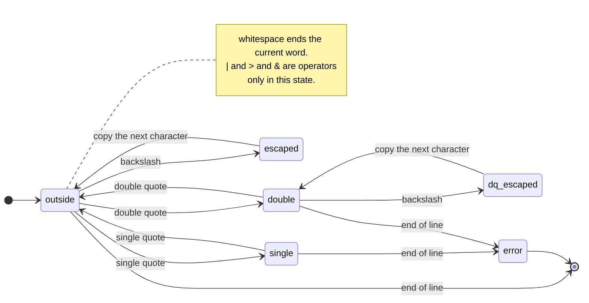

# M8: quoting and escaping

this one is in the lexer, at the `MILESTONE 8` comment in `ts_tokenize()`
(`src/parser.c`). sections 1 and 2 of [memory safety in
C](../concepts/memory-safety.md) are relevant, since you'll be writing into
a fixed buffer.

```
> echo 'a   b' "c   d" e\ f
a   b c   d e f
> echo '|' ">"
| >
> printf '[%s]\n' ''
[]
> echo 'oops
tinyshell: syntax error: unterminated quote
```

## the rules

inside single quotes everything is literal up to the next `'`. no
escapes, no variables.

inside double quotes everything is literal too, except that `$` still
expands (once you get to M9) and a backslash escapes `$`, `"` and `\`.

outside quotes, a backslash makes the next character literal, whatever it
is.

quotes don't split words: `ab"c d"e` is the single word `abc de`. and a
quoted operator is just text, so `echo '|'` prints a pipe character.

the lexer ends up as a small state machine. this is roughly what you're
building:



`error` is where you return `TS_LEX_UNTERMINATED_QUOTE`. M9 adds `$`
handling to `outside` and `double`, but not to `single`.

## where you're starting from

the lexer builds tokens one character at a time, in
`ts_token_list.storage`, through three helpers. `start_token()` opens a
token, `append_char()` adds a byte after checking there's room, and
`end_token()` writes the terminating `'\0'`.

operators are only recognised by `operator_length()`, and it only ever
looks at unquoted input. anything you append while inside quotes can't turn
into an operator, which is the behaviour you want.

## what to write

for a single quote: open a token if one isn't already open, then append
characters until the closing `'`. if you hit `'\0'` first, return
`TS_LEX_UNTERMINATED_QUOTE`.

open the token *before* appending anything. `''` has no characters in it
but it's still an argument, and `printf '[%s]' ''` needs to receive it.

for a backslash outside quotes, append the next character as-is and skip
over both. watch out for a backslash at the very end of the line; there's
no next character, and reading past the `'\0'` is a bug.

double quotes work like single quotes, plus the backslash rule, plus a
spot where M9's `$` handling will go.

always write through `append_char()` and check what it returns. never
index into `storage` yourself.

the M8 tests should pass under `make test MILESTONE=8` and `make test-debug
MILESTONE=8`, and `make test-unit` should still be clean.

## questions to try

1. why does quoting have to be handled in the lexer and not somewhere later?
2. in this design, how is a quoted `|` kept from being treated as a pipe?
3. what do `echo "a'b"` and `echo 'a"b'` print?

## if you want more

add your own cases to `tests/unit_tests.c`: empty words, quotes right next
to each other, a quote as the last character. or make an unfinished quote
ask for another line, the way bash shows a `> ` prompt.
