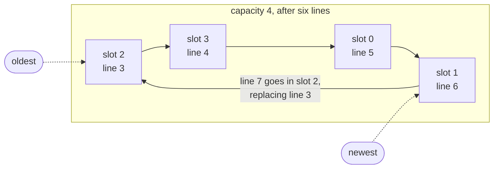

# M10: history

this one's optional, and there's no new systems concept in it, just a data
structure. the code goes in `src/history.c`.

```
> echo one
one
> ls
...
> history
    1  echo one
    2  ls
    3  history
```

`shell_step()` already passes every non-blank line to `ts_history_add()`
before running it, and the `history` builtin calls `ts_history_print()`.
both are empty.

## ring buffer

you only care about the last N lines, and the shell might run for days, so
the storage can't grow. a ring buffer is a fixed array that you write
into round and round, overwriting the oldest entry once it's full:



the boxes are in age order, oldest first, which is the order `history`
prints them in. slot numbers wrap from 3 back to 0, and the next write
lands on top of the oldest entry.

the line with index `n` (the first line is index 0) goes in slot
`n % capacity`. in the picture, "line 7" is index 6, and 6 % 4 is 2.

```c
#define TS_HISTORY_SIZE 100
static char entries[TS_HISTORY_SIZE][TS_MAX_LINE];
static int total_added;
```

that's 400 KB of static memory. fine on a desktop, but notice it.

`ts_history_add()` copies the line into slot `total_added % TS_HISTORY_SIZE`
with `snprintf()` and bumps the counter. `ts_history_print()` starts at
`total_added - TS_HISTORY_SIZE` (or 0, if that's negative), goes up to
`total_added - 1`, prints each as `"%5d  %s\n"` numbered from 1, and
returns 0.

the wrap-around is where off-by-one bugs live. try it with a capacity of 4
and ten lines before going back to 100.

## if you want more

save the history to `~/.tinyshell_history` when the shell exits (the end
of `main()`, thanks to M2) and load it on startup. add `!n` and `!!`.
arrow-key recall is a bigger project: you'd have to put the terminal into
raw mode with `tcsetattr()` and handle every key yourself. GNU readline
does that for you, but it's not POSIX, so TinyShell doesn't use it.
