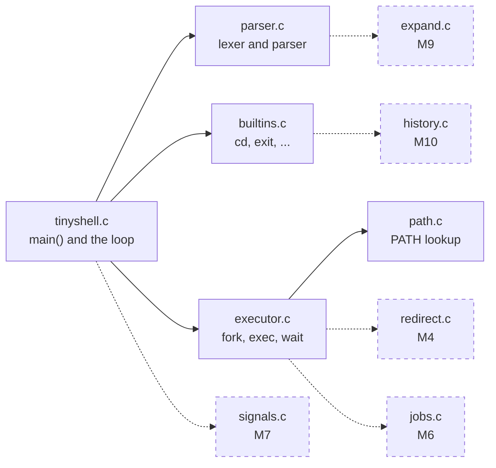

# A tour of the code

every file in `src/` does one thing, and none of them is long. this is a
reasonable order to read them in:

- `tinyshell.h`: the limits and exit statuses shared by everything else.
- `tinyshell.c`: `main()` and the read-run loop.
- `parser.c`: the lexer and the parser.
- `builtins.c`: `cd`, `exit`, and stubs for `export`, `unset`, `history`.
- `executor.c`: fork, exec and wait, plus the stubs for pipelines and
  background jobs.
- `path.c`: searching `$PATH`.
- `error.c`: `ts_error()` and `ts_errorx()`.

`redirect.c`, `jobs.c`, `signals.c`, `expand.c` and `history.c` are mostly
empty. those are for milestones 4 to 10.

here is how they connect. solid arrows are calls that already happen; the
dashed boxes are the files you'll fill in, and dashed arrows are where
their code gets called from. every file also reports errors through
`error.c`, which is left out to keep the picture readable.



a few calls are missing from the picture: the loop also calls
`ts_jobs_reap()` and `ts_history_add()` on every line, and `executor.c`
resets signals in each child.

## the structs

three structs in `parser.h` carry a line from text to something runnable:

```c
typedef struct {            /* one lexed token */
  char *text;
  bool is_operator;         /* unquoted | < > >> 2> & */
} ts_token;

typedef struct {            /* one program to run */
  char *argv[TS_MAX_ARGS];  /* NULL-terminated, ready for execv() */
  int argc;
  ts_redirect redirects[TS_MAX_REDIRECTS];
  int redirect_count;
} ts_command;

typedef struct {            /* everything on one line */
  ts_command commands[TS_MAX_PIPELINE];
  int count;
  bool background;
} ts_pipeline;
```

a plain `ls` is a pipeline with one command in it, so the executor only
has to handle one shape.

they're all fixed size and they live as local variables in `shell_step()`.
there's no `malloc()`, so nothing to free, and nothing left over from one
line can affect the next. the downside is hard limits, and when you hit
one the shell tells you instead of chopping your command short. the
[memory safety](concepts/memory-safety.md) chapter goes into why.

## conventions

public names start with `ts_`. headers use `#pragma once`.

each `.c` file includes its own header first, then system headers, then
other project headers. if a file uses `strlen()` it includes `<string.h>`
itself, even if some other header already pulled it in ("include what you
use").

errors go through one of two functions. `ts_error()` is for when a system
call failed and appends `strerror(errno)`; `ts_errorx()` is for everything
else. both start the message with `tinyshell:`.

the code is C11, built with `-Wall -Wextra -Wpedantic`, and should compile
with no warnings at all.

## finding the milestones

```sh
$ grep -rn "MILESTONE" src/          # every hook, in every file
$ grep -rn "TODO(M5)" src/           # the steps for one milestone
```

each `MILESTONE N` comment sits where the code needs to go, and the
`TODO(MN)` lines under it are the steps, in order.
